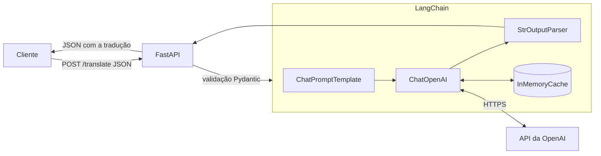

# Tradução Inglês para Francês com OpenAI, LangChain e FastAPI

API desenvolvida com FastAPI que recebe um texto em inglês e utiliza um modelo da OpenAI, integrado através do LangChain, para traduzi-lo para o francês.

## Arquitetura



- **FastAPI:** recebe a requisição, valida o JSON e expõe o endpoint assíncrono `/translate`.
- **LangChain:** monta o prompt de tradução, chama o modelo e extrai o texto da resposta.
- **OpenAI:** executa a tradução no modelo configurado (padrão `gpt-4o-mini`).

## Baixa latência e gerenciamento das chamadas

- Endpoint assíncrono com `ainvoke`, de modo que a API atende outras requisições enquanto aguarda a OpenAI.
- O cliente `ChatOpenAI` é criado uma única vez na inicialização e reaproveitado.
- `temperature=0` para traduções estáveis e `InMemoryCache` do LangChain para responder textos repetidos sem chamar a API novamente.
- `timeout=30` e `max_retries=2` para evitar requisições presas e repetir falhas temporárias.
- Erros da OpenAI são convertidos em respostas HTTP claras: chave inválida (`500`), limite de uso (`429`), tempo esgotado (`504`) e demais falhas (`502`).

## Estrutura

```
.
├── main.py           # criação da aplicação e tratamento dos erros da OpenAI
├── models.py         # modelos Pydantic de requisição e resposta
├── routes.py         # endpoints da API
├── services.py       # chain do LangChain com ChatOpenAI
├── .env.example      # variáveis de ambiente necessárias
└── requirements.txt
```

## Como executar

```bash
python3 -m venv venv
source venv/bin/activate
pip install -r requirements.txt
cp .env.example .env
```

Edite o arquivo `.env` com a sua chave da OpenAI:

```
OPENAI_API_KEY=sua-chave
OPENAI_MODEL=gpt-4o-mini
```

Inicie a aplicação:

```bash
uvicorn main:app --reload
```

Sem a variável `OPENAI_API_KEY` a aplicação não inicia. A documentação interativa fica disponível em http://127.0.0.1:8000/docs.

## Endpoints

| Método | Rota | Descrição |
|--------|------|-----------|
| GET | `/` | Verifica se a API está no ar |
| POST | `/translate` | Traduz um texto do inglês para o francês |

### POST /translate

```bash
curl -X POST http://127.0.0.1:8000/translate \
  -H "Content-Type: application/json" \
  -d '{"text": "Hello, how are you today?"}'
```

Resposta:

```json
{
  "model": "gpt-4o-mini",
  "source_language": "en",
  "target_language": "fr",
  "original_text": "Hello, how are you today?",
  "translated_text": "Bonjour, comment allez-vous aujourd'hui ?"
}
```
